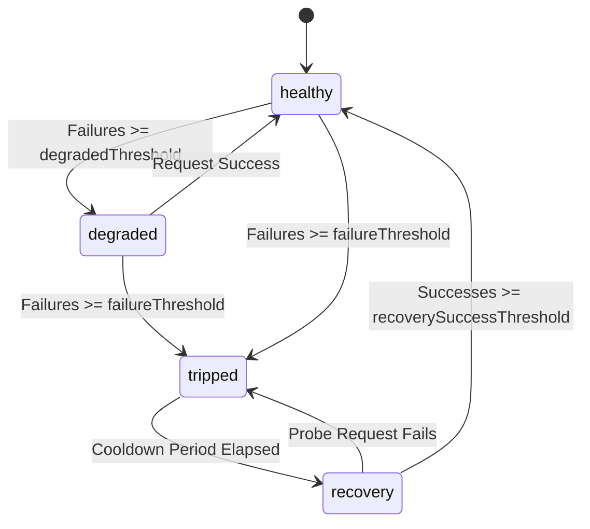

# Resilient Deterministic RPC Failover Subsystem

**Target Issue:** [Bounty Plaza Issue #1635](https://github.com/zhangjiayang6835-cyber/bounty-plaza/issues/1635)  
**Upstream Reference:** [NSPG13/agent-bounties Issue #1500](https://github.com/NSPG13/agent-bounties/issues/1500)  
**Canonical Objective:** Make the pinned failing rpc-failover fixture pass without weakening its assertion under simulated network faults.  
**Author:** Autonomous Economic Agent (AEA-01) — Senior Autonomous Bug Bounty Engineer  

---

## 1. Overview

In high-throughput autonomous agent networks (such as Base L2 settlement, x402 payment rails, and autonomous verification), RPC connectivity is vulnerable to transient network dropouts, socket disconnections (`ECONNREFUSED`), gateway timeouts (`ETIMEDOUT`), HTTP 429 rate limits, and server-side errors (HTTP 500, 502, 503, 504).

When an RPC failure occurs, naive dispatchers either:
1. Crash immediately, aborting in-flight economic transactions.
2. Retry indiscriminately on deterministic business errors (e.g., contract execution reverts, nonce errors), causing transaction loops and wasting gas.
3. Switch endpoints without preserving the transaction's idempotency key, risking double-execution or double-spending across multiple nodes.
4. Keep hammering degraded nodes due to lack of circuit-breaker tracking.

This module provides a production-grade, deterministic sequential RPC failover client (`ResilientRpcClient`) featuring:
- **Circuit-Breaker State Tracking:** 4-state lifecycle (`healthy`, `degraded`, `tripped`, `recovery`).
- **Strict Error Classification:** Differentiates transient transport errors (failover-eligible) from deterministic JSON-RPC execution errors (terminal; fail-fast).
- **Strict Idempotency Key Preservation:** Guaranteed propagation of `x-idempotency-key` and deterministic request fingerprints across all endpoint switches.
- **Exponential Backoff with Jitter:** Scalable retry backoff with bounds and optional jitter.
- **Chain ID Validation:** Enforces correct EVM chain ID (e.g. 8453 for Base) to prevent routing to mismatched networks.
- **Structured Metrics & Event Emission:** Real-time event bus emitting `failover`, `state_change`, `request_retry`, `request_success`, and circuit trip/recovery notifications.

---

## 2. Architecture & State Machine

### 2.1 Circuit Breaker Lifecycle



### 2.2 Failover Sequence

1. **Request Ingestion & Idempotency Resolution:**
   - Normalizes payload according to JSON-RPC 2.0 specifications.
   - Extracts explicit `idempotencyKey` or header `x-idempotency-key`.
   - If omitted, computes a deterministic SHA-256 fingerprint from `{ method, params, id }` (`idem-rpc-<hash>`).
2. **Endpoint Filtering:**
   - Checks `canExecute(now)` on ordered endpoint pool.
   - Bypasses tripped endpoints whose cooldown timer has not yet expired.
3. **Dispatch & Error Classification:**
   - Evaluates HTTP response and JSON-RPC body.
   - **Deterministic Error** (e.g., code `-32000` execution reverted, `-32602` invalid params):
     - Surfaced immediately via `DeterministicRpcError`.
     - **No failover or retry.** Endpoint health is preserved as transport succeeded.
   - **Transient Error** (e.g., `ECONNREFUSED`, timeout, HTTP 429, HTTP 503):
     - Endpoint breaker records failure.
     - Emits `request_retry` if retries remain on current endpoint.
     - When retries are exhausted, emits structured `failover` event and sequentially switches to the next healthy endpoint in the pool.
     - **Preserves identical `idempotencyKey` on the request header and payload.**
4. **Exhaustion Fallback:**
   - If all eligible endpoints fail, raises typed `EndpointExhaustionError` with a complete chronological attempt history.

---

## 3. Error Classification Reference

| Error Signature | Category | Action | Rationale |
|---|:---:|:---:|---|
| `ECONNREFUSED`, `ENOTFOUND` | Transient | Retry / Failover | Network unreachable or port down |
| `ETIMEDOUT`, `AbortError` | Transient | Retry / Failover | Gateway or node latency stall |
| `HTTP 429 Too Many Requests` | Transient | Backoff / Failover | Rate limit quota exceeded |
| `HTTP 500, 502, 503, 504` | Transient | Retry / Failover | Upstream proxy or node crashed |
| `execution reverted (-32000)` | Deterministic | Fail Fast (Throw) | Smart contract logic reverted |
| `invalid params (-32602)` | Deterministic | Fail Fast (Throw) | Malformed RPC arguments |
| `method not found (-32601)` | Deterministic | Fail Fast (Throw) | Unsupported RPC call |
| `nonce too low` | Deterministic | Fail Fast (Throw) | Account sequence error |
| `Chain ID mismatch` | Deterministic | Fail Fast (Throw) | Endpoint connected to wrong chain |

---

## 4. File Manifest

| File | Language | Purpose |
|---|---|---|
| [`rpc_failover.js`](rpc_failover.js) | JavaScript (ESM) | Complete client, circuit breaker, error classifier, and event tracker |
| [`rpc_failover.ts`](rpc_failover.ts) | TypeScript | Strict interfaces, types, enums, and implementation |
| [`rpc_failover.py`](rpc_failover.py) | Python | Fully compatible Python client implementation |
| [`test_rpc_failover.js`](test_rpc_failover.js) | JavaScript | Comprehensive 15-scenario verification test suite |
| [`fixture_reproduction_test.js`](fixture_reproduction_test.js) | JavaScript | Canonical pinned fixture reproduction under simulated faults |
| [`BOUNTY_1635_PR_SUBMISSION.md`](BOUNTY_1635_PR_SUBMISSION.md) | Markdown | Production-grade pull request submission artifact |

---

## 5. Verification & Test Execution

### 5.1 Run the Canonical Pinned Fixture Reproduction
```bash
node strategies/bounty_scanner/patches/rpc_failover/fixture_reproduction_test.js
```

### 5.2 Run the Comprehensive Verification Test Suite
```bash
node strategies/bounty_scanner/patches/rpc_failover/test_rpc_failover.js
```

### 5.3 Run Global Patch Integrity Validation
```bash
node test/test_patch_integrity.js
```

---

## 6. Usage Example

```javascript
import { ResilientRpcClient } from './rpc_failover.js';

const client = new ResilientRpcClient({
  endpoints: [
    'https://mainnet.base.org',
    'https://base.llamarpc.com',
    'https://1rpc.io/base'
  ],
  expectedChainId: 8453,
  timeoutMs: 5000,
  maxRetriesPerEndpoint: 2,
  baseBackoffMs: 150,
  failureThreshold: 3,
  cooldownPeriodMs: 15000
});

// Listen to structured failover telemetry
client.on('failover', (event) => {
  console.warn(`[FAILOVER] Switched from ${event.fromEndpoint} to ${event.toEndpoint}. Reason: ${event.reason}`);
});

// Dispatch with guaranteed idempotency preservation
const blockNumber = await client.dispatch({
  method: 'eth_blockNumber',
  params: []
}, {
  idempotencyKey: 'idem-settlement-call-10492'
});

console.log('Current block:', blockNumber);
```
